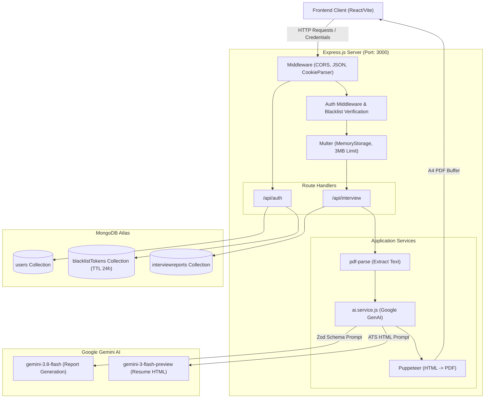
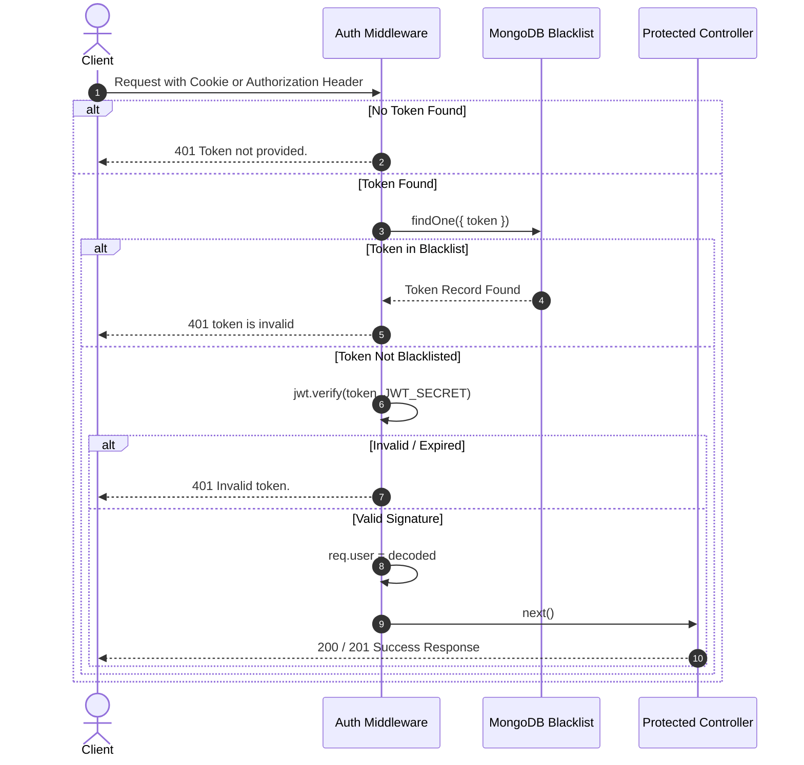

#  HireCraft - Backend Service

A high-performance Node.js & Express REST API that powers **Interview AI**, an intelligent career preparation platform. The service leverages **Google Gemini AI** (`@google/genai`), **Puppeteer**, and **MongoDB** to analyze resumes, evaluate candidate profiles against job descriptions, generate customized interview preparation reports, and produce tailored, ATS-friendly PDF resumes on demand.

---

##  Table of Contents

- [Overview](#-overview)
- [Key Features](#-key-features)
- [Tech Stack](#-tech-stack)
- [System Architecture](#-system-architecture)
- [Folder Structure](#-folder-structure)
- [Environment Variables](#-environment-variables)
- [Prerequisites & Installation](#-prerequisites--installation)
- [Database Schemas & Models](#-database-schemas--models)
- [API Documentation](#-api-documentation)
  - [Authentication Endpoints (`/api/auth`)](#authentication-endpoints-apiauth)
  - [Interview Endpoints (`/api/interview`)](#interview-endpoints-apiinterview)
- [AI & PDF Generation Pipeline](#-ai--pdf-generation-pipeline)
- [Security & Authentication Flow](#-security--authentication-flow)
- [Scripts & Execution](#-scripts--execution)
- [Troubleshooting & Common Issues](#-troubleshooting--common-issues)

---

##  Overview

The **Interview AI Backend** bridges candidate data with Google's latest Gemini models. It receives candidate resumes in PDF format along with job descriptions, extracts the raw textual data in memory, and passes structured prompts into Gemini models with strict schema constraints enforced by **Zod**.

The platform returns actionable interview intelligence:
1. **Candidate-Job Match Score** (0-100%).
2. **Role-Specific Technical Questions** with expected concepts, intentions, and model answers.
3. **Behavioral & Situational Questions** with answer guidance.
4. **Skill Gap Identification** classified by severity level (`low`, `medium`, `high`).
5. **Day-by-Day Preparation Plan** with targeted focus areas and action items.
6. **AI-Tailored ATS Resume** rendered dynamically as an A4 PDF document using headless Puppeteer.

---

##  Key Features

- **Robust Authentication & Session Management**:
  - Secure password hashing with `bcryptjs` (10 rounds).
  - Stateless JSON Web Tokens (JWT) stored in HTTP cookies or transmitted via `Authorization: Bearer` headers.
  - Active session invalidation via MongoDB TTL-indexed token blacklisting.
- **In-Memory Resume PDF Parsing**:
  - Multipart upload handler using `multer` with memory storage and file size caps (3 MB).
  - High-speed raw text extraction via `pdf-parse`.
- **Structured AI Output via Google Gemini with Resilient Failover**:
  - Integration with `@google/genai` utilizing adaptive multi-model failover (`gemini-3-flash-preview`, `gemini-flash-lite-latest`, `gemini-3.5-flash-lite`, `gemini-3.8-flash`) for maximum resilience against high-demand spikes.
  - Strict output schemas enforced using native `@google/genai` `Type` definitions (`responseMimeType: "application/json"`).
- **Headless PDF Compilation**:
  - Converts dynamically generated semantic HTML resumes into clean, ATS-compliant A4 PDF files using `puppeteer` with automated system browser discovery and pipe transport.
  - Streams binary PDF files with appropriate attachment headers directly to the client.
- **Comprehensive Report Persistence & History**:
  - Stores full interview reports in MongoDB linked by user reference.
  - Supports quick historical overview fetching (optimized projection excluding heavy text fields).

---

## 🛠 Tech Stack

| Category | Technology | Version | Purpose |
| :--- | :--- | :--- | :--- |
| **Runtime** | [Node.js](https://nodejs.org/) | `>= 18.x` | JavaScript server runtime environment |
| **Framework** | [Express.js](https://expressjs.com/) | `^5.2.1` | RESTful API routing and middleware framework |
| **Database** | [MongoDB](https://www.mongodb.com/) / [Mongoose](https://mongoosejs.com/) | `^9.10.3` | Document database and object data modeling (ODM) |
| **AI / LLM** | [@google/genai](https://www.npmjs.com/package/@google/genai) | `^2.31.0` | Google Gemini API SDK (`gemini-3.8-flash` & `gemini-3-flash-preview`) |
| **Validation** | [Zod](https://zod.dev/) & [zod-to-json-schema](https://www.npmjs.com/package/zod-to-json-schema) | `^4.6.7` / `^3.25.2` | Schema definition & JSON schema conversion for Gemini structured output |
| **PDF Extraction**| [pdf-parse](https://www.npmjs.com/package/pdf-parse) | `^2.4.5` | In-memory text extraction from uploaded PDF resumes |
| **PDF Generation**| [Puppeteer](https://pptr.dev/) | `^25.16.0` | Headless Chromium for rendering HTML resumes to A4 PDF |
| **File Upload** | [Multer](https://github.com/expressjs/multer) | `^2.5.0` | Multipart/form-data upload middleware |
| **Auth & Security**| [jsonwebtoken](https://github.com/auth0/node-jsonwebtoken) | `^9.0.3` | JWT creation, verification, and claims inspection |
| | [bcryptjs](https://github.com/dcodeIO/bcrypt.js) | `^3.0.3` | Salted password hashing |
| | [cookie-parser](https://github.com/expressjs/cookie-parser) | `^1.4.7` | Parse and manage HTTP cookies |
| | [cors](https://github.com/expressjs/cors) | `^2.8.6` | Cross-Origin Resource Sharing handling |
| **Configuration** | [dotenv](https://github.com/motdotla/dotenv) | `^18.0.5` | Environment variable management |
| **Dev Tooling** | [nodemon](https://nodemon.io/) | Latest | Automatic server restarts on code changes |

---

## System Architecture



---

## 📁 Folder Structure

```
Backend/
├── src/
│   ├── config/
│   │   └── database.js
│   ├── controllers/
│   │   ├── auth.controller.js
│   │   └── interview.controller.js
│   ├── middlewares/
│   │   ├── auth.middleware.js
│   │   └── file.middleware.js
│   ├── models/
│   │   ├── blacklist.model.js
│   │   ├── interviewReport.model.js
│   │   └── user.model.js
│   ├── routes/
│   │   ├── auth.routes.js
│   │   └── interview.routes.js
│   ├── services/
│   │   └── ai.service.js
│   └── app.js
├── tests/
│   └── backend.test.js
├── package-lock.json
├── package.json
├── README.md
└── server.js
```


---

## Environment Variables

Create a `.env` file in the root of the `Backend/` directory based on the included `.env.example`:

```bash
# Server Port
PORT=3000

# MongoDB Connection String (Atlas or Local MongoDB instance)
MONGO_URI=mongodb+srv://<username>:<password>@<cluster-url>/interview-master?retryWrites=true&w=majority

# JWT Signing Secret (Use a strong, 256-bit random string)
JWT_SECRET=your_super_secret_jwt_key_here

# Google Gemini API Key (Obtain from Google AI Studio: https://aistudio.google.com/)
GOOGLE_GENAI_API_KEY=your_google_gemini_api_key_here
```

### Environment Variable Reference

| Variable | Required | Description | Example / Notes |
| :--- | :---: | :--- | :--- |
| `PORT` | Optional | Port on which the Express server listens. | `3000` (defaults to 3000 in `server.js`) |
| `MONGO_URI` | **Yes** | Connection string for MongoDB database instance. | `mongodb+srv://...` |
| `JWT_SECRET` | **Yes** | Secret key used to sign and verify JSON Web Tokens. | Random 64-hex string recommended |
| `GOOGLE_GENAI_API_KEY` | **Yes** | Google Cloud / AI Studio API key for Gemini access. | `AQ.Ab8...` |

---

## Prerequisites & Installation

### Prerequisites

- [Node.js](https://nodejs.org/) version **18.x** or higher installed.
- [MongoDB](https://www.mongodb.com/) running locally or an active [MongoDB Atlas](https://www.mongodb.com/cloud/atlas) cluster.
- A valid [Google Gemini API Key](https://aistudio.google.com/).

### Installation Steps

1. **Navigate to the Backend directory**:
   ```bash
   cd Backend
   ```

2. **Install project dependencies**:
   ```bash
   npm install
   ```
   *(Note: This downloads Chromium required by Puppeteer automatically).*

3. **Configure Environment Variables**:
   ```bash
   cp .env.example .env
   # Edit .env and supply your MONGO_URI, JWT_SECRET, and GOOGLE_GENAI_API_KEY
   ```

4. **Start the Development Server**:
   ```bash
   npm run dev
   ```
   The server will start with Nodemon at `http://localhost:3000`.

5. **Start in Production Mode**:
   ```bash
   node server.js
   ```

---

## 🗄 Database Schemas & Models

### 1. User Model (`src/models/user.model.js`)

Represents registered users within the system.

```javascript
{
  username: { type: String, required: true, unique: true },
  email:    { type: String, required: true, unique: true },
  password: { type: String, required: true } // Stored as bcrypt hash
}
```

### 2. Token Blacklist Model (`src/models/blacklist.model.js`)

Implements secure logout invalidation. Tokens added here are rejected by `auth.middleware.js` and automatically purged by MongoDB after 24 hours.

```javascript
{
  token:     { type: String, required: true, unique: true },
  createdAt: { type: Date, default: Date.now, expires: 86400 } // MongoDB TTL index (1 day)
}
```

### 3. Interview Report Model (`src/models/interviewReport.model.js`)

Stores generated reports, candidate inputs, and structured AI evaluation data.

```javascript
{
  user:             { type: mongoose.Schema.Types.ObjectId, ref: "users" },
  title:            { type: String, required: true }, // Job title parsed or assigned
  jobDescription:   { type: String, required: true },
  resume:           { type: String },                 // Raw text parsed from resume PDF
  selfDescription:  { type: String },                 // Candidate self-introduction
  matchScore:       { type: Number, min: 0, max: 100 },
  technicalQuestions: [
    {
      question:  { type: String, required: true },
      intention: { type: String, required: true },
      answer:    { type: String, required: true }
    }
  ],
  behavioralQuestions: [
    {
      question:  { type: String, required: true },
      intention: { type: String, required: true },
      answer:    { type: String, required: true }
    }
  ],
  skillGaps: [
    {
      skill:    { type: String, required: true },
      severity: { type: String, enum: ["low", "medium", "high"], required: true }
    }
  ],
  preparationPlan: [
    {
      day:   { type: Number, required: true },
      focus: { type: String, required: true },
      tasks: [{ type: String, required: true }]
    }
  ],
  createdAt: { type: Date },
  updatedAt: { type: Date }
}
```

---

## API Documentation

Base URL: `http://localhost:3000/api`

### Summary of Endpoints

| Resource | Method | Endpoint | Access | Description |
| :--- | :--- | :--- | :---: | :--- |
| **Auth** | `POST` | `/api/auth/register` | Public | Register a new user account |
| **Auth** | `POST` | `/api/auth/login` | Public | Authenticate user and receive JWT |
| **Auth** | `GET` | `/api/auth/logout` | Public | Invalidate token and clear cookie |
| **Auth** | `GET` | `/api/auth/get-me` | Private | Retrieve logged-in user details |
| **Interview** | `POST` | `/api/interview/` | Private | Upload resume & generate AI interview report |
| **Interview** | `GET` | `/api/interview/` | Private | Fetch all interview reports for current user |
| **Interview** | `GET` | `/api/interview/report/:interviewId` | Private | Fetch a single detailed interview report by ID |
| **Interview** | `POST` | `/api/interview/resume/pdf/:interviewReportId` | Private | Generate & download tailored ATS resume PDF |

---

### Authentication Endpoints (`/api/auth`)

#### 1. Register User
- **Route**: `POST /api/auth/register`
- **Access**: Public
- **Headers**: `Content-Type: application/json`
- **Request Body**:
  ```json
  {
    "username": "alex_developer",
    "email": "alex@example.com",
    "password": "SecurePassword123"
  }
  ```
- **Success Response (201 Created)**:
  - *Sets `Set-Cookie: token=<jwt_token>; Max-Age=86400; Path=/`*
  ```json
  {
    "message": "User created successfully",
    "user": {
      "id": "6727be554045f448b3dae812",
      "username": "alex_developer",
      "email": "alex@example.com"
    }
  }
  ```
- **Error Responses**:
  - `400 Bad Request`: `{"message": "Please fill all the fields"}` or `{"message": "User already exists"}`

---

#### 2. Login User
- **Route**: `POST /api/auth/login`
- **Access**: Public
- **Headers**: `Content-Type: application/json`
- **Request Body**:
  ```json
  {
    "email": "alex@example.com",
    "password": "SecurePassword123"
  }
  ```
- **Success Response (200 OK)**:
  - *Sets `Set-Cookie: token=<jwt_token>; Max-Age=86400; Path=/`*
  ```json
  {
    "message": "Login successful",
    "user": {
      "id": "6727be554045f448b3dae812",
      "username": "alex_developer",
      "email": "alex@example.com"
    }
  }
  ```
- **Error Responses**:
  - `400 Bad Request`: `{"message": "Please fill all the fields"}`
  - `404 Not Found`: `{"message": "User not found"}`
  - `401 Unauthorized`: `{"message": "Invalid credentials"}`

---

#### 3. Logout User
- **Route**: `GET /api/auth/logout`
- **Access**: Public (Token provided via Cookie, `Authorization: Bearer <token>`, `token` header, or body)
- **Success Response (200 OK)**:
  - *Clears the `token` cookie and inserts the token into the blacklist collection.*
  ```json
  {
    "message": "Logout successful"
  }
  ```
- **Error Responses**:
  - `400 Bad Request`: `{"message": "No token provided. Cannot logout without a token."}`
  - `500 Internal Server Error`: `{"message": "Error logging out", "error": "..."}`

---

#### 4. Get Current User Profile
- **Route**: `GET /api/auth/get-me`
- **Access**: Private (Requires valid JWT)
- **Headers**: `Authorization: Bearer <token>` or valid cookie
- **Success Response (200 OK)**:
  ```json
  {
    "message": "User details fetched successfully",
    "user": {
      "id": "6727be554045f448b3dae812",
      "username": "alex_developer",
      "email": "alex@example.com"
    }
  }
  ```
- **Error Responses**:
  - `401 Unauthorized`: `{"message": "Token not provided."}` or `{"message": "token is invalid"}`
  - `404 Not Found`: `{"message": "User not found"}`

---

### Interview Endpoints (`/api/interview`)

All interview routes require authentication. Supply the token via cookie or `Authorization: Bearer <token>` header.

#### 1. Generate Interview Report
Analyzes the candidate's resume (PDF file) against the provided job description and self-description to generate a full interview preparation report.

- **Route**: `POST /api/interview/`
- **Access**: Private
- **Headers**: `Content-Type: multipart/form-data`
- **Form Data Parameters**:
  - `resume`: Binary PDF file (Max 3MB, required)
  - `jobDescription`: Text string describing the target role and duties (required)
  - `selfDescription`: Text string describing the candidate's background and achievements (optional/recommended)
- **Example cURL**:
  ```bash
  curl -X POST http://localhost:3000/api/interview \
    -H "Authorization: Bearer YOUR_TOKEN_HERE" \
    -F "resume=@/path/to/resume.pdf" \
    -F "jobDescription=Senior Full Stack Engineer proficient in React, Node.js, and MongoDB..." \
    -F "selfDescription=Full stack developer with 4 years of experience building scalable SaaS apps..."
  ```
- **Success Response (201 Created)**:
  ```json
  {
    "message": "Interview report generated successfully.",
    "interviewReport": {
      "_id": "672809e6c46a2a0d922bb03f",
      "user": "6727be554045f448b3dae812",
      "title": "Senior Full Stack Engineer",
      "matchScore": 85,
      "jobDescription": "Senior Full Stack Engineer proficient in React, Node.js, and MongoDB...",
      "selfDescription": "Full stack developer with 4 years of experience...",
      "technicalQuestions": [
        {
          "question": "How do you handle race conditions in distributed Node.js transactions with MongoDB?",
          "intention": "Evaluate deep concurrency and distributed systems knowledge.",
          "answer": "Explain two-phase commits, optimistic concurrency control via document version keys (__v), and distributed locking mechanisms like Redis Redlock."
        }
      ],
      "behavioralQuestions": [
        {
          "question": "Tell me about a time an outage occurred in production. How did you respond?",
          "intention": "Assess composure under fire, post-mortem methodology, and communication.",
          "answer": "Use the STAR method: Situation (production degradation), Task (triage and mitigate), Action (rolled back deployment, stabilized DB pools), Result (restored in 12 min, implemented automated canary tests)."
        }
      ],
      "skillGaps": [
        {
          "skill": "Kubernetes Orchestration",
          "severity": "medium"
        }
      ],
      "preparationPlan": [
        {
          "day": 1,
          "focus": "Core Architecture & Advanced Node.js Concurrency",
          "tasks": [
            "Review Node.js event loop phases and worker threads.",
            "Implement MongoDB replica set transaction retry logic."
          ]
        }
      ],
      "createdAt": "2026-11-03T15:20:06.120Z",
      "updatedAt": "2026-11-03T15:20:06.120Z"
    }
  }
  ```

---

#### 2. Get All Interview Reports (User History)
Retrieves a lightweight summary list of all reports previously created by the authenticated user, sorted in descending chronological order. Heavy content fields (`resume`, `selfDescription`, `jobDescription`, `technicalQuestions`, `behavioralQuestions`, `skillGaps`, `preparationPlan`) are excluded to optimize response payload size.

- **Route**: `GET /api/interview/`
- **Access**: Private
- **Headers**: `Authorization: Bearer <token>`
- **Success Response (200 OK)**:
  ```json
  {
    "message": "Interview reports fetched successfully.",
    "interviewReports": [
      {
        "_id": "672809e6c46a2a0d922bb03f",
        "title": "Senior Full Stack Engineer",
        "matchScore": 85,
        "createdAt": "2026-11-03T15:20:06.120Z",
        "updatedAt": "2026-11-03T15:20:06.120Z"
      }
    ]
  }
  ```

---

#### 3. Get Single Interview Report By ID
Retrieves the complete interview report including all questions, answers, intentions, skill gaps, and preparation schedules.

- **Route**: `GET /api/interview/report/:interviewId`
- **Access**: Private
- **Headers**: `Authorization: Bearer <token>`
- **URL Parameters**:
  - `interviewId`: The MongoDB ObjectId of the report.
- **Success Response (200 OK)**:
  ```json
  {
    "message": "Interview report fetched successfully.",
    "interviewReport": {
      "_id": "672809e6c46a2a0d922bb03f",
      "user": "6727be554045f448b3dae812",
      "title": "Senior Full Stack Engineer",
      "matchScore": 85,
      "jobDescription": "...",
      "resume": "...",
      "selfDescription": "...",
      "technicalQuestions": [ ... ],
      "behavioralQuestions": [ ... ],
      "skillGaps": [ ... ],
      "preparationPlan": [ ... ],
      "createdAt": "2026-11-03T15:20:06.120Z"
    }
  }
  ```
- **Error Responses**:
  - `404 Not Found`: `{"message": "Interview report not found."}`

---

#### 4. Generate & Download Tailored Resume PDF
Uses Google Gemini to craft an ATS-tailored resume HTML based on the report's candidate profile and job requirements, compiles it with Puppeteer, and streams an A4 PDF document back to the client.

- **Route**: `POST /api/interview/resume/pdf/:interviewReportId`
- **Access**: Private
- **Headers**: `Authorization: Bearer <token>`
- **URL Parameters**:
  - `interviewReportId`: The MongoDB ObjectId of the target report.
- **Success Response (200 OK)**:
  - **Headers**:
    - `Content-Type: application/pdf`
    - `Content-Disposition: attachment; filename=resume_<interviewReportId>.pdf`
  - **Body**: Binary PDF stream.
- **Error Responses**:
  - `404 Not Found`: `{"message": "Interview report not found."}`
  - `500 Internal Server Error`: `{"message": "Error generating PDF..."}`

---

## AI & PDF Generation Pipeline

### 1. Schema-Enforced Gemini Report Generation

In `src/services/ai.service.js`, the `@google/genai` client connects using `process.env.GOOGLE_GENAI_API_KEY`. The `generateInterviewReport` function defines a **Zod** schema that models the entire report structure:

```javascript
const interviewReportSchema = z.object({
  matchScore: z.number().describe("0 to 100 score indicating candidate match"),
  technicalQuestions: z.array(z.object({ question, intention, answer })),
  behavioralQuestions: z.array(z.object({ question, intention, answer })),
  skillGaps: z.array(z.object({ skill, severity: z.enum(["low", "medium", "high"]) })),
  preparationPlan: z.array(z.object({ day, focus, tasks: z.array(z.string()) })),
  title: z.string().describe("Job title")
});
```

Using `zodToJsonSchema(interviewReportSchema)` and `responseMimeType: "application/json"`, Gemini is constrained to return strictly typed, syntactically valid JSON.

### 2. Puppeteer A4 PDF Compilation

The tailored resume workflow (`generateResumePdf`) requests Gemini (`gemini-3-flash-preview`) to generate ATS-friendly HTML. The HTML is then processed by Puppeteer:

1. Launches a headless Chrome browser instance.
2. Creates a fresh blank page and sets HTML content with `waitUntil: "networkidle0"`.
3. Renders the page as a standardized **A4 PDF** with exact margins:
   - **Top / Bottom**: `20mm`
   - **Left / Right**: `15mm`
4. Closes the browser to free memory resources and returns the `pdfBuffer`.

---

## 🛡 Security & Authentication Flow



### Key Security Safeguards:
1. **Password Salt & Hashing**: All passwords are encrypted with `bcryptjs.hash(password, 10)` before insertion. Plaintext passwords are never logged or stored.
2. **Dual-Extraction JWT Middleware**: `auth.middleware.js` checks both cookies (`req.cookies.token`) and the `Authorization` header (`Bearer <token>`).
3. **Logout Invalidation**: Because JWTs are stateless by default, the server records invalidated tokens in a MongoDB `blacklistTokens` collection. A MongoDB TTL index removes entries after 24 hours (matching token expiration).
4. **File Size Hard Limits**: Multer is constrained with `limits: { fileSize: 3 * 1024 * 1024 }` (3 MB) to prevent Denial of Service (DoS) memory exhaustion.
5. **CORS Isolation**: Strict origin handling configured for the frontend origin (`http://localhost:5173`) with `credentials: true`.

---

## Scripts & Execution

The available `npm` scripts defined in `package.json`:

```bash
# Start backend in development mode with hot-reloading (via nodemon)
npm run dev

# Start backend directly with Node (production mode)
node server.js
```

---

## Troubleshooting & Common Issues

### 1. `Error: Chromium revision is not downloaded` (Puppeteer)
- **Cause**: Puppeteer needs Chromium binaries to render PDF resumes. On some environments or fresh installs, Chromium download may be skipped or blocked by proxy settings.
- **Fix**: Run `npx puppeteer browsers install chrome` or re-run `npm install puppeteer`.

### 2. `GoogleGenAI: API key not valid`
- **Cause**: Missing or incorrect `GOOGLE_GENAI_API_KEY` in the `.env` file.
- **Fix**: Check that `.env` contains a valid key from [Google AI Studio](https://aistudio.google.com/). Ensure `dotenv.config()` runs before initializing the Gemini client (configured in `server.js`).

### 3. `MongooseServerSelectionError: connect ECONNREFUSED`
- **Cause**: The server cannot reach the MongoDB instance specified in `MONGO_URI`.
- **Fix**:
  - If using MongoDB Atlas: Verify your IP address is whitelisted in MongoDB Atlas Network Access (`0.0.0.0/0` for development).
  - If using local MongoDB: Ensure the `mongod` service is running (`systemctl status mongod` or MongoDB Windows Service).

### 4. `MulterError: File too large`
- **Cause**: Uploaded resume file exceeds the 3MB limit configured in `src/middlewares/file.middleware.js`.
- **Fix**: Upload a compressed or text-focused PDF resume under 3MB.

---

## Contributing & License

Developed as part of the **Interview AI** platform. Built with Node.js, Express, Google GenAI, and MongoDB.
