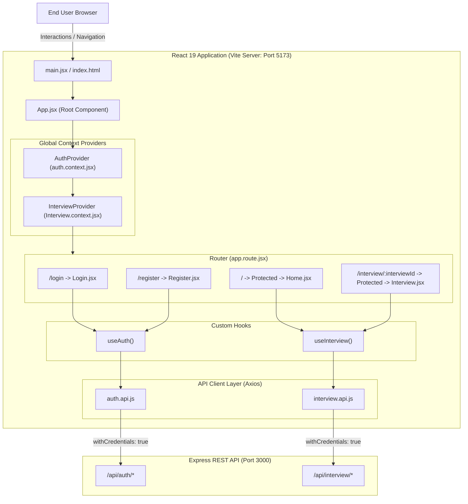

# HireCraft - Frontend Application

A modern, responsive Single Page Application (SPA) built with React 19 and Vite. The frontend serves as the user-facing portal for the Interview AI platform, allowing candidates to register, authenticate, submit their resume and target job descriptions, explore AI-generated interview preparation reports, view match scores and skill gap analyses, and download tailored, ATS-friendly PDF resumes.

---

## Table of Contents

- [HireCraft - Frontend Application](#hirecraft---frontend-application)
  - [Table of Contents](#table-of-contents)
  - [Overview](#overview)
  - [Key Features](#key-features)
  - [Tech Stack](#tech-stack)
  - [System Architecture](#system-architecture)
  - [Folder Structure](#folder-structure)
  - [Component and Feature Hierarchy](#component-and-feature-hierarchy)
    - [1. Authentication Domain (`src/features/auth`)](#1-authentication-domain-srcfeaturesauth)
    - [2. Interview Domain (`src/features/interview`)](#2-interview-domain-srcfeaturesinterview)
  - [State Management and Context Architecture](#state-management-and-context-architecture)
    - [Context Comparison](#context-comparison)
  - [Routing and Navigation](#routing-and-navigation)
  - [API Integration and Services](#api-integration-and-services)
    - [1. Authentication Service (`src/features/auth/services/auth.api.js`)](#1-authentication-service-srcfeaturesauthservicesauthapijs)
    - [2. Interview Service (`src/features/interview/services/interview.api.js`)](#2-interview-service-srcfeaturesinterviewservicesinterviewapijs)
  - [Styling Architecture and Design System](#styling-architecture-and-design-system)
  - [Prerequisites and Installation](#prerequisites-and-installation)
    - [Prerequisites](#prerequisites)
    - [Installation Steps](#installation-steps)
  - [Development and Build Scripts](#development-and-build-scripts)
  - [Troubleshooting and Common Issues](#troubleshooting-and-common-issues)
    - [1. Network Error or Failed API Requests](#1-network-error-or-failed-api-requests)
    - [2. Unauthorized or Endless Redirect to `/login`](#2-unauthorized-or-endless-redirect-to-login)
    - [3. Resume File Upload Rejected](#3-resume-file-upload-rejected)
    - [4. Resume PDF Download Does Not Start](#4-resume-pdf-download-does-not-start)

---

## Overview

The Interview AI Frontend provides an interactive experience for job seekers preparing for interviews. It communicates with the Express.js backend via an authenticated Axios instance configured with credential support.

The application allows users to:
1. Authenticate securely via credentials stored in HTTP cookies and managed through an authentication context.
2. Provide a target job description and either upload a PDF resume or submit a quick self-description.
3. Review AI-synthesized interview preparation reports, including technical questions, behavioral scenarios, model answers, interviewer intentions, and a structured preparation roadmap.
4. Visualize candidate-to-job match scores and categorized skill gaps.
5. Generate and download a tailored ATS resume as a formatted PDF directly to their local machine.

---


## Key Features

- Single Page Application Architecture: Powered by React 19, React Router 8, and Vite for fast navigation and instant hot module replacement (HMR).
- Modular Feature-Based Organization: Organized into distinct business domains (`auth` and `interview`) with dedicated components, hooks, contexts, and API services.
- Route Protection and Session Verification: Centralized `Protected` route wrapper verifying authentication state and redirecting unauthorized visitors to `/login`.
- Dual Profile Input Methods: Supports direct resume file upload (PDF/DOCX up to 5MB) via an interactive drag-and-drop dropzone or textual self-description input.
- Interactive Interview Intelligence Interface:
  - Multi-tab navigation switching between Technical Questions, Behavioral Questions, and Road Map.
  - Collapsible accordion question cards displaying the interviewer's hidden intention and structured model answers.
  - Multi-day preparation roadmap breaking down daily study areas into actionable bullet points.
  - Color-coded match score ring (High: >= 80%, Medium: >= 60%, Low: < 60%).
  - Skill gap chips categorized by severity levels (`low`, `medium`, `high`).
- Binary PDF Resume Download: Triggers backend headless rendering and downloads the resulting binary blob with dynamic filename attribution in the browser.
- Dark-Themed UI: Styled with Sass (SCSS) using a consistent dark color palette, smooth active button transitions, and responsive flex/grid layouts.

---

## Tech Stack

| Category | Technology | Version | Purpose |
| :--- | :--- | :--- | :--- |
| Framework / UI Library | React | ^19.2.8 | Declarative component-based UI rendering |
| DOM Renderer | React DOM | ^19.2.8 | React rendering entry point for web browsers |
| Build Tool & Dev Server | Vite | ^8.3.0 | Fast ESM-based bundling and dev server |
| Routing | React Router | ^8.4.0 | Declarative client-side routing (`createBrowserRouter`, `RouterProvider`) |
| HTTP Client | Axios | ^1.20.0 | Promise-based HTTP client with cookie credential support |
| Stylesheet Preprocessor | Sass (Dart Sass) | ^1.105.1 | SCSS variables, nesting, and modular styles |
| Linting | ESLint | ^10.10.0 | Code quality and React Hooks lint rules |
| React Vite Plugin | @vitejs/plugin-react | ^6.1.1 | React Fast Refresh support |

---

## System Architecture



---

## Folder Structure

```

Frontend/
├── public/
│   ├── readme-assets/
│   │   ├── HireCraft-Banner-Image.jfif
│   │   └── HireCraft-Banner-Image.png
│   ├── HireCraft-Favicon.jfif
│   └── HireCraft-Favicon.png
├── src/
│   ├── features/
│   │   ├── auth/
│   │   │   ├── components/
│   │   │   │   └── Protected.jsx
│   │   │   ├── hooks/
│   │   │   │   └── useAuth.js
│   │   │   ├── pages/
│   │   │   │   ├── Login.jsx
│   │   │   │   └── Register.jsx
│   │   │   ├── services/
│   │   │   │   └── auth.api.js
│   │   │   ├── auth.context.jsx
│   │   │   └── auth.form.scss
│   │   ├── interview/
│   │   │   ├── hooks/
│   │   │   │   └── useInterview.js
│   │   │   ├── pages/
│   │   │   │   ├── Home.jsx
│   │   │   │   └── Interview.jsx
│   │   │   ├── services/
│   │   │   │   └── interview.api.js
│   │   │   ├── style/
│   │   │   │   ├── home.scss
│   │   │   │   └── interview.scss
│   │   │   └── Interview.context.jsx
│   │   ├── landing/
│   │   │   ├── components/
│   │   │   │   ├── FeaturesSection.jsx
│   │   │   │   ├── HeroPreviewCard.jsx
│   │   │   │   ├── PublicFooter.jsx
│   │   │   │   ├── PublicNavbar.jsx
│   │   │   │   └── WorkflowSection.jsx
│   │   │   └── pages/
│   │   │       └── Landing.jsx
│   │   └── styles/
│   │       ├── _tokens.scss
│   │       └── button.scss
│   ├── styles/
│   │   ├── abstracts/
│   │   │   ├── _functions.scss
│   │   │   ├── _index.scss
│   │   │   ├── _mixins.scss
│   │   │   ├── _motion.scss
│   │   │   ├── _tokens.scss
│   │   │   └── _typography.scss
│   │   ├── base/
│   │   │   ├── _base.scss
│   │   │   └── _reset.scss
│   │   ├── components/
│   │   │   ├── _badges.scss
│   │   │   ├── _buttons.scss
│   │   │   ├── _cards.scss
│   │   │   ├── _inputs.scss
│   │   │   ├── _loader.scss
│   │   │   ├── _preview-card.scss
│   │   │   ├── _score.scss
│   │   │   └── _workflow.scss
│   │   ├── layout/
│   │   │   ├── _footer.scss
│   │   │   ├── _grid.scss
│   │   │   ├── _navbar-public.scss
│   │   │   ├── _navigation.scss
│   │   │   └── _rail.scss
│   │   ├── pages/
│   │   │   ├── _auth.scss
│   │   │   ├── _home.scss
│   │   │   ├── _interview.scss
│   │   │   └── _landing.scss
│   │   └── main.scss
│   ├── App.jsx
│   ├── app.route.jsx
│   ├── main.jsx
│   └── style.scss
├── eslint.config.js
├── index.html
├── package-lock.json
├── package.json
├── README.md
└── vite.config.js

---

```

## Component and Feature Hierarchy

### 1. Authentication Domain (`src/features/auth`)

- `AuthProvider` (`auth.context.jsx`): Wraps the entire application. Houses `user` and `loading` states.
- `useAuth` (`hooks/useAuth.js`):
  - On mount, triggers `getMe()` to check existing session cookies and populate user state.
  - Exposes `handleLogin({ email, password })`, `handleRegister({ username, email, password })`, and `handleLogout()`.
- `Protected` (`components/Protected.jsx`):
  - Guards child routes against unauthenticated users.
  - Renders a loading message if auth status is resolving.
  - Redirects to `/login` via React Router's `<Navigate>` if `user` is null.
- `Login` (`pages/Login.jsx`):
  - Form capturing email and password.
  - Navigates to `/` upon successful authentication.
- `Register` (`pages/Register.jsx`):
  - Form capturing username, email, and password.
  - Navigates to `/` upon successful registration.

### 2. Interview Domain (`src/features/interview`)

- `InterviewProvider` (`Interview.context.jsx`):
  - Manages global interview states: `report` (current active report), `reports` (list of user's past reports), and `loading`.
- `useInterview` (`hooks/useInterview.js`):
  - Dispatches calls to `interview.api.js`.
  - Automatically loads report details when an `interviewId` route parameter is present; otherwise fetches all past reports.
  - Encapsulates binary PDF download logic through browser object URLs.
- `Home` (`pages/Home.jsx`):
  - Dual-panel interface: Target job description textarea on the left, profile ingestion on the right.
  - Supports file drag-and-drop or manual file selection (`.pdf`, `.docx`).
  - Fallback quick self-description field.
  - Displays a summary list of past generated plans with clickable navigation to `/interview/:id`.
- `Interview` (`pages/Interview.jsx`):
  - 3-column layout: Section navigation on the left, central content display, and metric sidebar on the right.
  - Sub-components:
    - `QuestionCard`: Collapsible card displaying the question title, interviewer intention tag, and detailed model answer.
    - `RoadMapDay`: Daily schedule card with focus area and bulleted list of actionable study tasks.
  - Sidebar: Circular match score percentage display with dynamic color classes and severity-tagged skill gap chips.
  - Action button: Direct trigger for downloading the AI-generated ATS-friendly resume as a PDF.

---

## State Management and Context Architecture

State management is handled via React's built-in Context API without external overhead. Providers are nested at the root level in `App.jsx`:

```jsx
<AuthProvider>
  <InterviewProvider>
    <RouterProvider router={router} />
  </InterviewProvider>
</AuthProvider>
```

### Context Comparison

| Context Name | Primary States | Key Actions | Consumed By |
| :--- | :--- | :--- | :--- |
| **AuthContext** | `user`, `loading` | `handleLogin`, `handleRegister`, `handleLogout` | `Protected`, `Login`, `Register`, `useAuth` |
| **InterviewContext** | `report`, `reports`, `loading` | `generateReport`, `getReportById`, `getReports`, `getResumePdf` | `Home`, `Interview`, `useInterview` |

---

## Routing and Navigation

Client-side routes are configured in `src/app.route.jsx` using `createBrowserRouter`:

| Path | Element | Route Protection | Description |
| :--- | :--- | :---: | :--- |
| `/login` | `<Login />` | Public | User sign-in page |
| `/register` | `<Register />` | Public | Account registration page |
| `/` | `<Protected><Home /></Protected>` | Protected | Dashboard, report generation, and plan history |
| `/interview/:interviewId` | `<Protected><Interview /></Protected>` | Protected | Detailed interview report viewer and resume PDF export |

---

## API Integration and Services

All outbound HTTP calls are made using `axios` instances pointing to the backend service. Both API modules specify `withCredentials: true` to ensure JWT cookies are automatically included and accepted across origins.

### 1. Authentication Service (`src/features/auth/services/auth.api.js`)

- `register({ username, email, password })`:
  - Method: `POST`
  - Endpoint: `http://localhost:3000/api/auth/register`
  - Sends user credentials; receives user payload and sets session cookie.
- `login({ email, password })`:
  - Method: `POST`
  - Endpoint: `http://localhost:3000/api/auth/login`
  - Authenticates user; receives user payload and sets session cookie.
- `logout()`:
  - Method: `GET`
  - Endpoint: `http://localhost:3000/api/auth/logout`
  - Signals backend to blacklist token and clear client cookie.
- `getMe()`:
  - Method: `GET`
  - Endpoint: `http://localhost:3000/api/auth/get-me`
  - Validates current cookie session and returns profile data.

### 2. Interview Service (`src/features/interview/services/interview.api.js`)

- `generateInterviewReport({ jobDescription, selfDescription, resumeFile })`:
  - Method: `POST`
  - Endpoint: `http://localhost:3000/api/interview/`
  - Format: `multipart/form-data` containing `resume` (File), `jobDescription` (string), and `selfDescription` (string).
- `getInterviewReportById(interviewId)`:
  - Method: `GET`
  - Endpoint: `http://localhost:3000/api/interview/report/:interviewId`
  - Fetches complete report details for the given ID.
- `getAllInterviewReports()`:
  - Method: `GET`
  - Endpoint: `http://localhost:3000/api/interview/`
  - Returns a list of past interview reports for the logged-in user.
- `generateResumePdf({ interviewReportId })`:
  - Method: `POST`
  - Endpoint: `http://localhost:3000/api/interview/resume/pdf/:interviewReportId`
  - Options: `{ responseType: "blob" }`
  - Streams binary PDF data converted into a client-side download via `URL.createObjectURL`.

---

## Styling Architecture and Design System

The styling is implemented using modular SCSS:

- Global Styles (`src/style.scss`):
  - Global reset (`margin: 0; padding: 0; box-sizing: border-box;`).
  - Base background color: `#1B1B1B`.
  - Base typography color: `white`.
  - Default full height and width bindings.
- Button Styles (`src/features/styles/button.scss`):
  - `.button`: Rounded borders (`1rem`), smooth transition (`0.3s ease-in-out`), active scale reduction (`transform: scale(0.9)`).
  - `.primary-button`: Background `#e1034d`, white text.
- Forms (`src/features/auth/auth.form.scss`):
  - Centered card containers, styled input groups, field labels, and call-to-action buttons.
- Interview & Home Layouts (`src/features/interview/style/`):
  - Two-panel splitters, character counters, drag-and-drop borders, accordion animation rules, and badge tag styling.

---

## Prerequisites and Installation

### Prerequisites

- Node.js version 18.x or higher installed.
- Running Interview AI Backend on `http://localhost:3000`.

### Installation Steps

1. Navigate to the Frontend directory:
   ```bash
   cd Frontend
   ```

2. Install dependencies:
   ```bash
   npm install
   ```

3. Launch development server:
   ```bash
   npm run dev
   ```
   The application will be accessible at `http://localhost:5173`.

---

## Development and Build Scripts

The following scripts are defined in `package.json`:

```bash
# Start Vite local development server with Hot Module Replacement
npm run dev

# Compile and bundle assets for production deployment into the dist/ directory
npm run build

# Run ESLint to verify code quality and style conventions
npm run lint

# Preview the production build locally
npm run preview
```

---

## Troubleshooting and Common Issues

### 1. Network Error or Failed API Requests
- Cause: The backend server is not running or is listening on a different port.
- Solution: Ensure the backend is active at `http://localhost:3000`. Check that MongoDB connection succeeded on the backend.

### 2. Unauthorized or Endless Redirect to `/login`
- Cause: Cookie not being stored or cross-origin credentials blocked by browser settings.
- Solution: Verify that both `auth.api.js` and `interview.api.js` have `withCredentials: true`. Check that the backend CORS middleware specifically specifies `origin: "http://localhost:5173"` and `credentials: true`.

### 3. Resume File Upload Rejected
- Cause: File exceeds the 3MB backend Multer limit or file type is unsupported.
- Solution: Ensure the uploaded resume is a valid PDF format under 3MB.

### 4. Resume PDF Download Does Not Start
- Cause: Pop-up blockers or issues creating object URLs from the response blob.
- Solution: Verify network response status for `POST /api/interview/resume/pdf/:id`. Confirm the browser allows automatic downloads from `localhost`.
