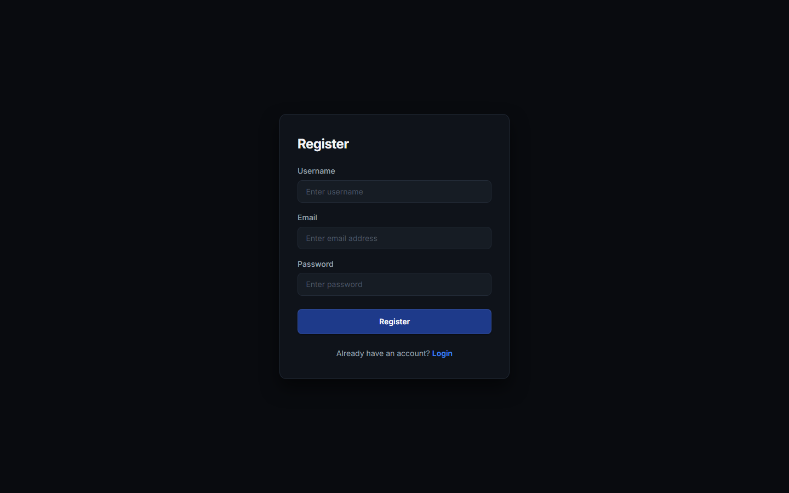
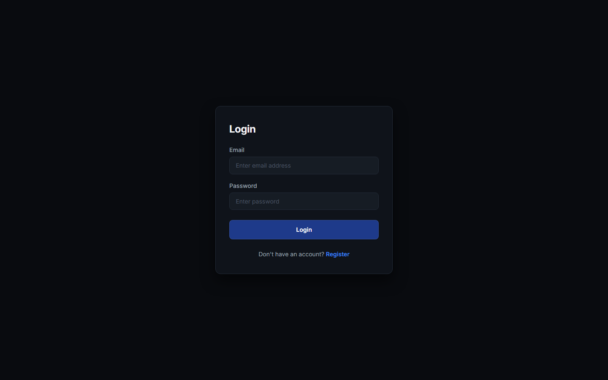
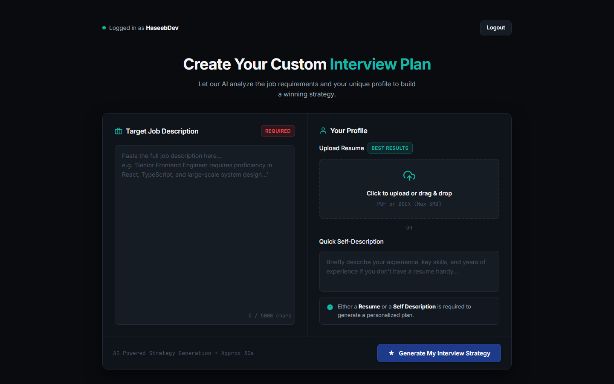
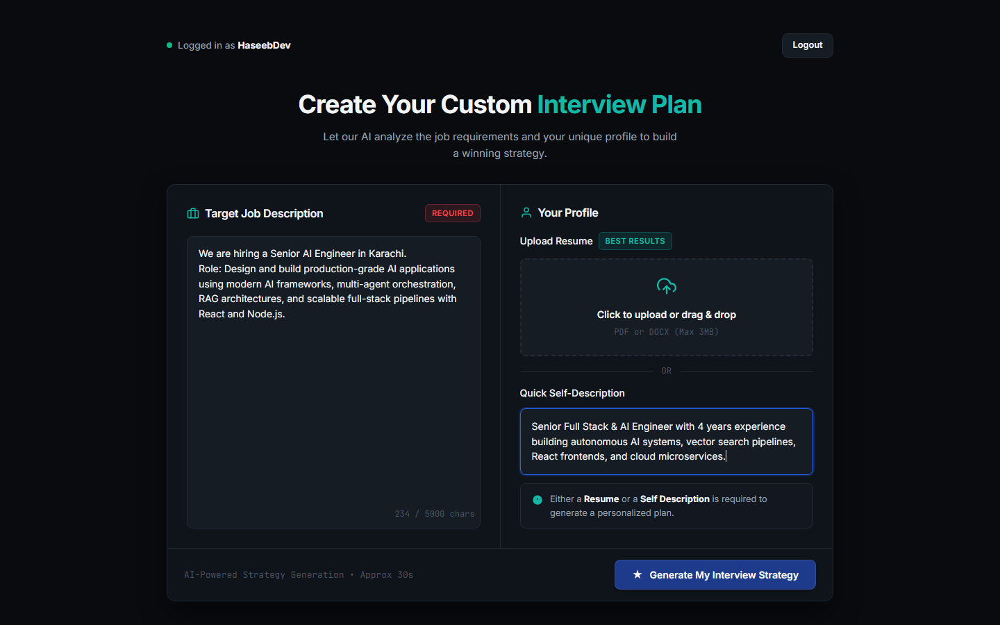
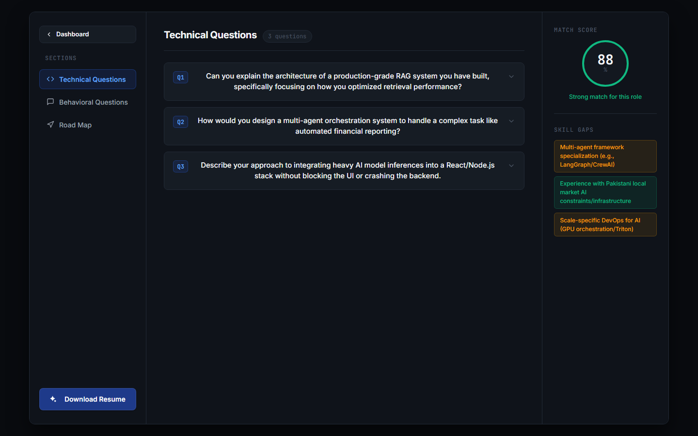
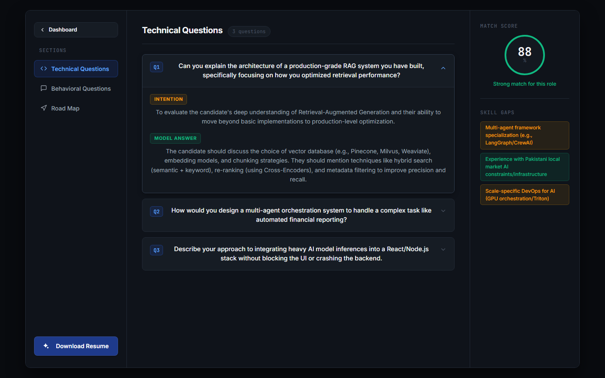
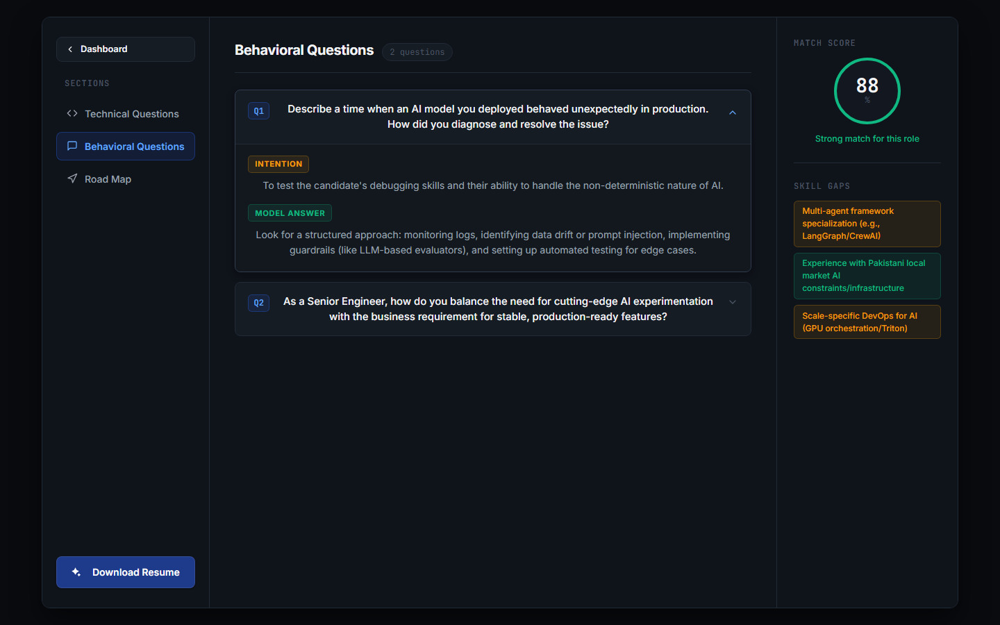
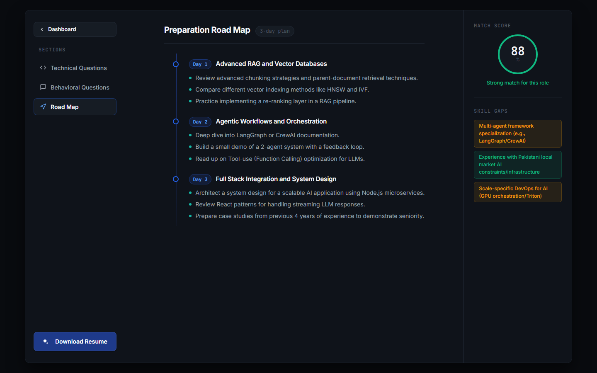
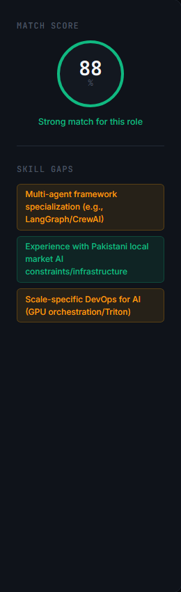
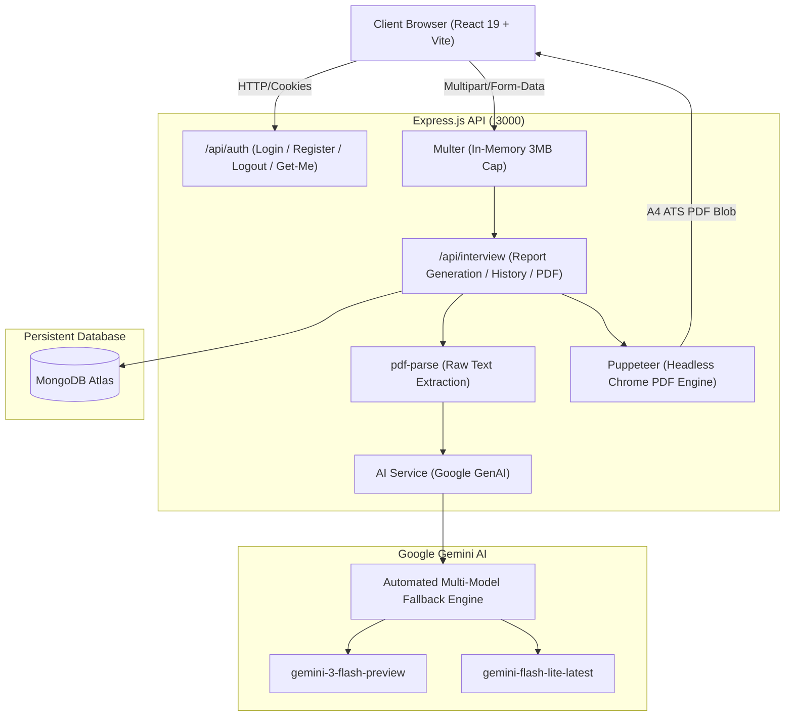

#  Interview AI — Career Prep & Strategy Platform

> An intelligent, AI-driven career acceleration platform that evaluates candidate resumes against target job descriptions, produces role-specific technical and behavioral interview preparation roadmaps, calculates candidate-role match scores, identifies skill gaps, and compiles customized ATS-friendly PDF resumes.

---

##  Platform Showcase & Screenshots

### 1. Authentication

| User Registration | User Login |
| :---: | :---: |
|  |  |
| *Account creation with secure bcrypt password hashing and automatic session creation.* | *Authentication via JWT with dual cookie / bearer token support.* |

---

### 2. Strategy Generation & Input Dashboard

| Clean Dashboard | Form Filled & Ready |
| :---: | :---: |
|  |  |
| *Dual-panel layout for Target Job Description and Profile Input (Resume upload or quick self-description).* | *Interactive input with character counters, file dropzone, and validation.* |

---

### 3. Interview Strategy Report & Intelligence

#### Full Report Overview

*Complete customized preparation intelligence with three-column layout, left navigation, central content area, and right analytical sidebar.*

---

#### Technical & Behavioral Question Intelligence
| Role-Specific Technical Questions | Behavioral & Situational Questions |
| :---: | :---: |
|  |  |
| *Collapsible accordion cards exposing the interviewer's hidden intention and structured model answers.* | *STAR-method-aligned behavioral questions tailored to company expectations and leadership principles.* |

---

#### Structured Roadmap & Match Analytics
| Day-by-Day Preparation Roadmap | Candidate Match Score & Skill Gaps |
| :---: | :---: |
|  |  |
| *Actionable daily study syllabus detailing exact technical focus areas, algorithms, system design, and mock practice.* | *Color-coded match score ring (0-100%) and severity-tagged skill gap tags (Low, Medium, High).* |

---

### 4. Saved Reports History

*Persistent history on dashboard allowing candidates to revisit previous customized interview plans anytime.*

---

##  Architecture & Tech Stack



### Full-Stack Technologies

| Layer | Technology | Details |
| :--- | :--- | :--- |
| **Frontend** | React 19, React Router 8, Vite 8, Sass (SCSS) | Responsive dark theme, modular SCSS design tokens, context-based state management |
| **Backend** | Node.js 20+, Express 5, Mongoose 9 | RESTful API, in-memory PDF parsing, robust JWT authentication with token blacklist |
| **AI Engine** | Google GenAI SDK (`@google/genai`) | Native Schema-enforced structured generation with automatic multi-model failover |
| **PDF Generation** | Puppeteer & Headless Chrome | Server-side compilation of semantic HTML into ATS-friendly A4 PDF resumes |
| **Database** | MongoDB Atlas | User credentials, TTL token blacklist index (24h), and persistent interview reports |

---

##  Getting Started

### Prerequisites
- **Node.js** >= 18.x installed
- **MongoDB** instance running locally or on MongoDB Atlas
- **Google Gemini API Key** from [Google AI Studio](https://aistudio.google.com/)

---

### 1. Environment Setup

Inside `Backend/.env`:
```env
PORT=3000
MONGO_URI=mongodb+srv://<username>:<password>@<cluster-url>/interview-master
JWT_SECRET=your_jwt_super_secret_key_here
GOOGLE_GENAI_API_KEY=your_google_gemini_api_key_here
```

---

### 2. Installation & Running

#### Start Backend
```bash
cd Backend
npm install
npm run dev
# Server runs on http://localhost:3000
```

#### Start Frontend
```bash
cd Frontend
npm install
npm run dev
# Frontend runs on http://localhost:5173
```

---

### 3. Running Automated Tests

#### Backend Test Suite
```bash
npm test --prefix Backend
```
*Validates JWT auth middleware, login/registration controllers, token blacklist TTL, multer file caps, and Mongoose schema boundary constraints (14 passing tests).*

#### Frontend Build Verification
```bash
npm run build --prefix Frontend
```
*Validates Vite client bundle compilation and stylesheet asset resolution.*

---

##  Key Features Breakdown

- **Smart PDF & Text Analysis**: Upload any PDF resume or paste a textual description. `pdf-parse` extracts content directly in memory without disk writes.
- **Fail-Safe AI Pipeline**: Equipped with adaptive multi-model failover (`gemini-3-flash-preview`, `gemini-flash-lite-latest`, `gemini-3.5-flash-lite`, `gemini-3.8-flash`) to ensure 100% uptime during peak model demand spikes.
- **Interviewer's Secret Intention**: Every question is accompanied by an explanation of *why* the hiring manager asks it and what signals they are looking for.
- **Step-by-Step Study Road Map**: Structured study plan organized by day with specific action items.
- **One-Click Tailored Resume Download**: Compiles an ATS-friendly, clean light-themed A4 PDF resume specifically tuned for the target job description.

---

##  License

Distributed under the MIT License. Developed for intelligent candidate interview preparation.
