<div align="center">

# HireCraft 

## UI & Visual Design Showcase

### A Comprehensive Visual Tour of the Light Editorial Studio Aesthetic

[](README.md)
[](Frontend/src/styles/)
[](Frontend/src/styles/)
[](#visual-walkthrough)

</div>

---

## Design System Foundations

HireCraft departs from ubiquitous dark-mode tech dashboards and generic Bootstrap templates in favor of a calm, tactile, publication-grade **Light Editorial Studio** aesthetic. 

Every view is calibrated for sustained cognitive focus during high-stakes career preparation:

```
┌────────────────────────────────────────────────────────────────────────┐
│  SURFACE PALETTE                                                       │
│  ├── Paper Canvas:      #F6F2EA (Warm, non-glare reading surface)      │
│  ├── Card Surface:      #FFFFFF (Clean editorial contrast card)        │
│  ├── Muted Fill:        #EFE9DD (Subtle inset panels & dropzones)      │
│                                                                        │
│  INK & ACCENT TOKENS                                                   │
│  ├── Deep Ink:          #1A1A1A (High-contrast typographic copy)       │
│  ├── Cobalt Focal:      #2D3FE0 (Intentional primary action color)     │
│  ├── Terracotta Alert:  #C85A32 (Critical skill gaps & error alerts)   │
│  ├── Sage Signal:       #3B7A57 (Strong matches & validated states)    │
│  ├── Butter Warning:    #E8C868 (Moderate gaps & cautionary tags)      │
│                                                                        │
│  TYPOGRAPHIC SYSTEM                                                    │
│  ├── Fraunces:          Display serif with optical sizing (Headlines)  │
│  ├── Manrope:           Humanist grotesque interface sans (Body/Forms) │
│  └── JetBrains Mono:    Monospaced numerals, metadata chips, code      │
└────────────────────────────────────────────────────────────────────────┘
```

---

## Table of Contents

- [HireCraft](#hirecraft)
  - [UI \& Visual Design Showcase](#ui--visual-design-showcase)
    - [A Comprehensive Visual Tour of the Light Editorial Studio Aesthetic](#a-comprehensive-visual-tour-of-the-light-editorial-studio-aesthetic)
  - [Design System Foundations](#design-system-foundations)
  - [Table of Contents](#table-of-contents)
  - [1. Landing Page Experience](#1-landing-page-experience)
  - [2. Sectional Breakdown of the Landing Page](#2-sectional-breakdown-of-the-landing-page)
    - [Navigation Bar](#navigation-bar)
    - [Hero \& Live Preview](#hero--live-preview)
    - [3-Step Interactive Workflow](#3-step-interactive-workflow)
    - [Features Grid \& Tactile Footer](#features-grid--tactile-footer)
  - [3. Asymmetric Authentication Split](#3-asymmetric-authentication-split)
    - [User Registration](#user-registration)
    - [User Login](#user-login)
  - [4. Candidate Workspace \& Input Flow](#4-candidate-workspace--input-flow)
  - [5. Multi-Stage Generation State Machine](#5-multi-stage-generation-state-machine)
  - [6. 3-Column Interview Strategy Intelligence Report](#6-3-column-interview-strategy-intelligence-report)
    - [Technical Questions Intelligence](#technical-questions-intelligence)
    - [STAR Behavioral Scenarios](#star-behavioral-scenarios)
    - [Structured 5-Day Preparation Roadmap](#structured-5-day-preparation-roadmap)
    - [Match Score Arc \& Categorized Skill Gaps](#match-score-arc--categorized-skill-gaps)
  - [7. Saved Reports History Grid](#7-saved-reports-history-grid)
  - [8. Design System Evolution (Before vs After)](#8-design-system-evolution-before-vs-after)
  - [9. Accessibility \& Micro-Interaction Standards](#9-accessibility--micro-interaction-standards)

---

## 1. Landing Page Experience

The public face of HireCraft pairs an editorial brand wordmark with tactile typography, asymmetric spacing, and an interactive live preview card demonstrating the platform's core output.

| Desktop View (1440×900) | Mobile View (390×844) |
| :---: | :---: |
|  | 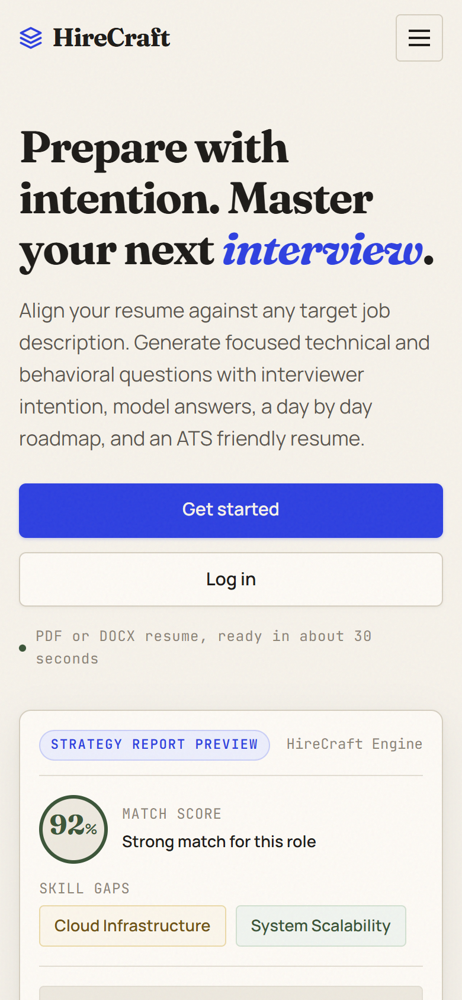 |
| *Editorial landing hero featuring live preview card, sticky navigation bar, and clean value proposition.* | *Fluid single-column mobile layout with accessible drawer navigation and thumb-friendly CTAs.* |

---

## 2. Sectional Breakdown of the Landing Page

### Navigation Bar
Sticky top navigation that adds a tactile blur and hairline border upon scrolling.

| Desktop Navigation | Mobile Closed | Mobile Drawer Open |
| :---: | :---: | :---: |
| 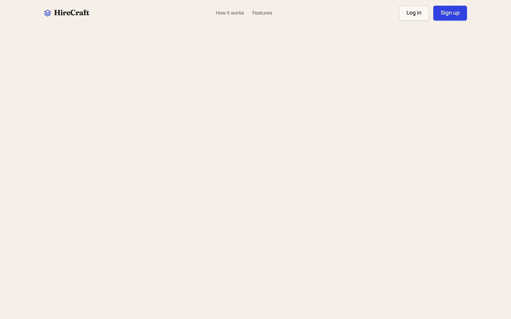 | 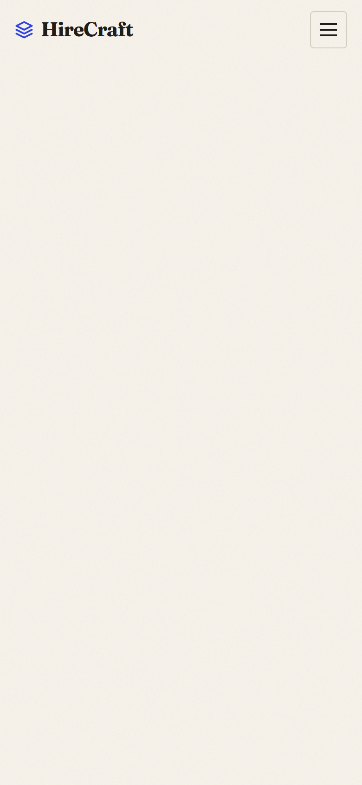 | 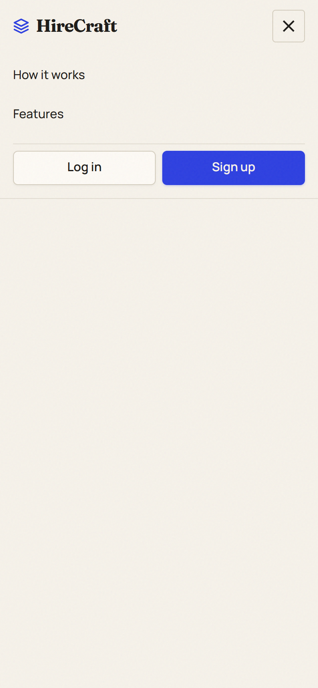 |
| *Brand mark, anchor links, and primary portal button.* | *Compact mobile header with accessible toggle.* | *Full-viewport slide-in mobile navigation drawer.* |

### Hero & Live Preview
An asymmetrical hero pairing a bold Fraunces display headline with a simulated live interview intelligence card.

| Desktop Hero View | Mobile Hero View |
| :---: | :---: |
| 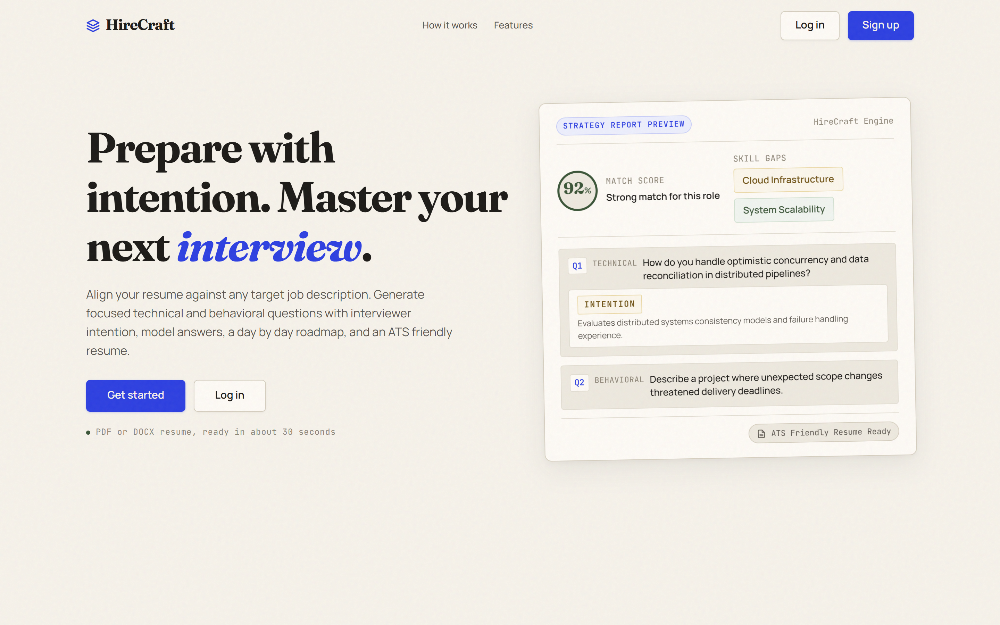 |  |
| *Dynamic interactive preview simulating real-time match scores and questions.* | *Stacked layout maintaining clarity without visual crowding.* |

### 3-Step Interactive Workflow
Explaining the ingestion, semantic AI analysis, and interview roadmap output.

| Desktop Workflow | Mobile Workflow |
| :---: | :---: |
|  |  |
| *3-column step progression with delicate step connectors and hover elevation.* | *Sequential timeline cards optimized for mobile vertical scrolling.* |

### Features Grid & Tactile Footer
Highlighting deep ATS resume matching, STAR behavioral question frameworks, and export features.

| Features Grid (Desktop) | CTA & Footer (Desktop) |
| :---: | :---: |
| 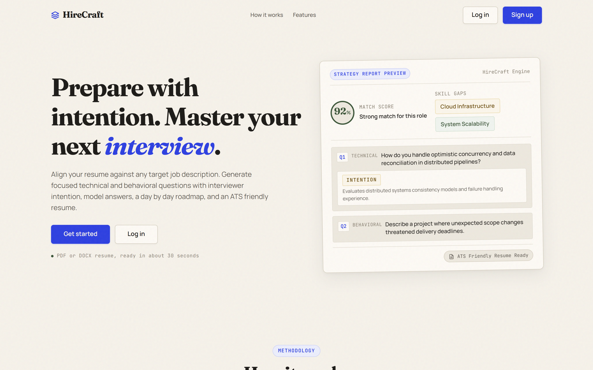 |  |
| *Calibrated grid cards with hairline borders and subtle paper elevation.* | *Full-width editorial CTA card transitioning to tactile publication footer.* |

---

## 3. Asymmetric Authentication Split

Authentication screens utilize an editorial asymmetric split layout: a rich editorial brand statement panel on one side and a tactile paper form card on the other.

### User Registration

| Desktop Split (1440×900) | Mobile View (390×844) |
| :---: | :---: |
| 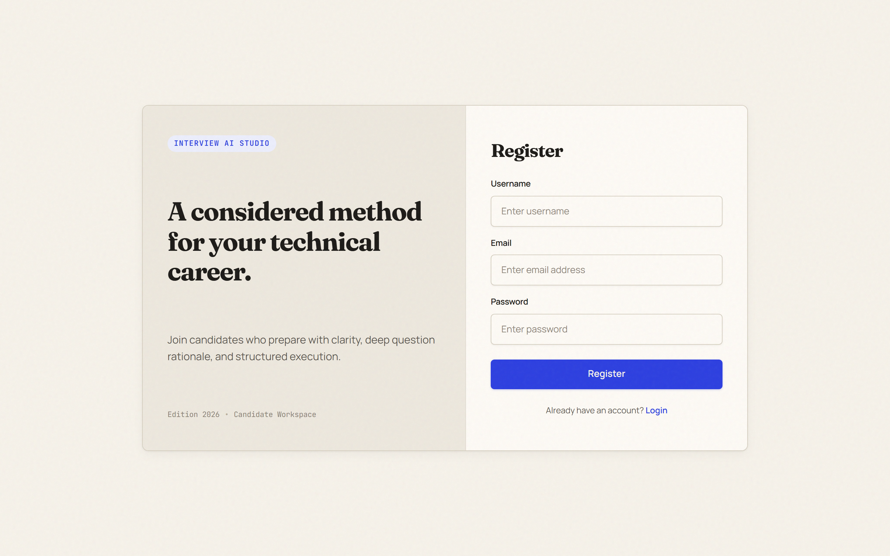 | 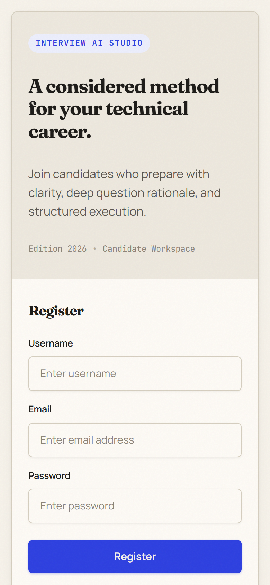 |
| *Brand statement panel with quote typography alongside responsive form fields.* | *Single-column stack with generous touch targets and instant login link.* |

### User Login

| Desktop Split (1440×900) | Mobile View (390×844) |
| :---: | :---: |
| 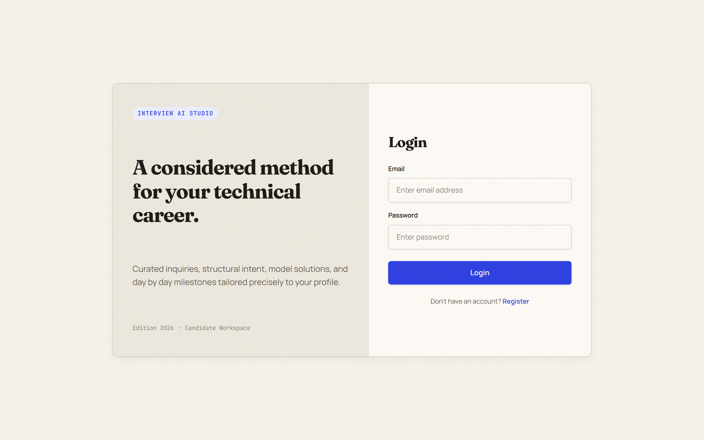 | 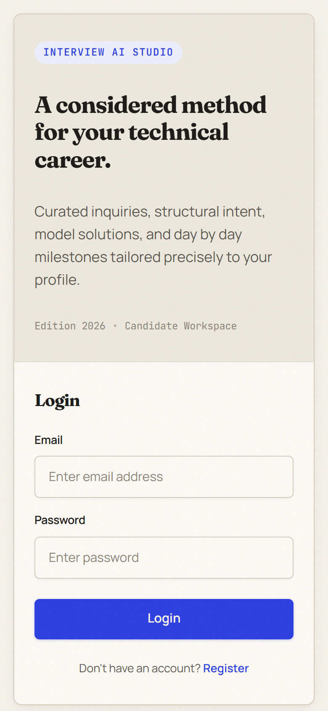 |
| *Crisp paper card with terracotta alerts, password mask toggle, and cobalt focus states.* | *Clean mobile form view with instant link to registration.* |

---

## 4. Candidate Workspace & Input Flow

The authenticated workspace allows candidates to drop an existing resume PDF and paste the target job description.

| Initial Blank Workspace | Workspace with Inputs Populated |
| :---: | :---: |
| 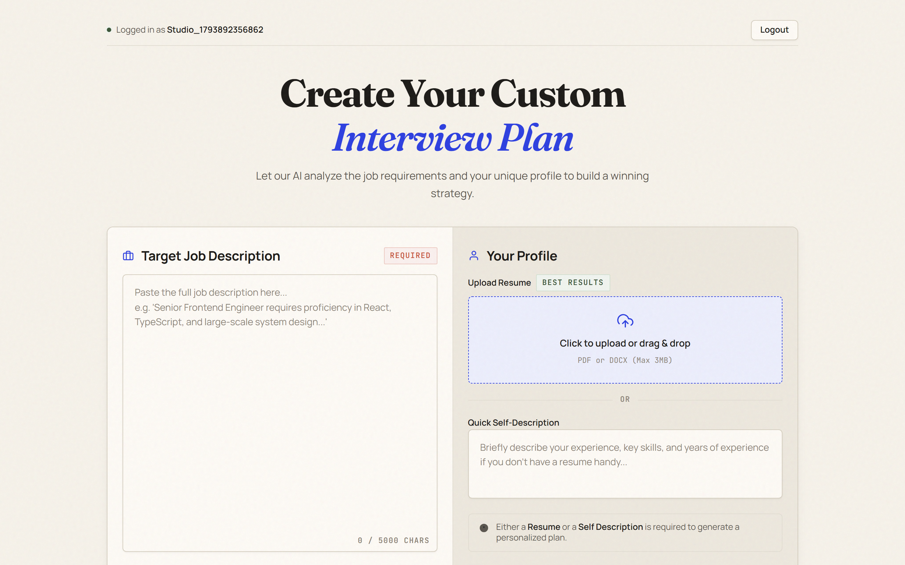 | 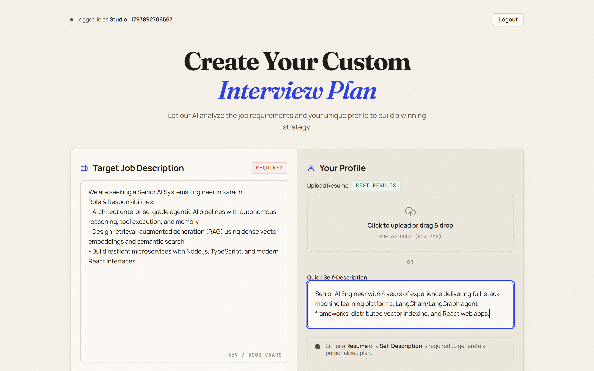 |
| *Clean dropzone with drag-over indicator and empty job description textarea.* | *Uploaded file pill with file size and remove action, live counter, and cobalt CTA.* |

| Mobile Workspace View | Mobile Inputs Filled |
| :---: | :---: |
|  | 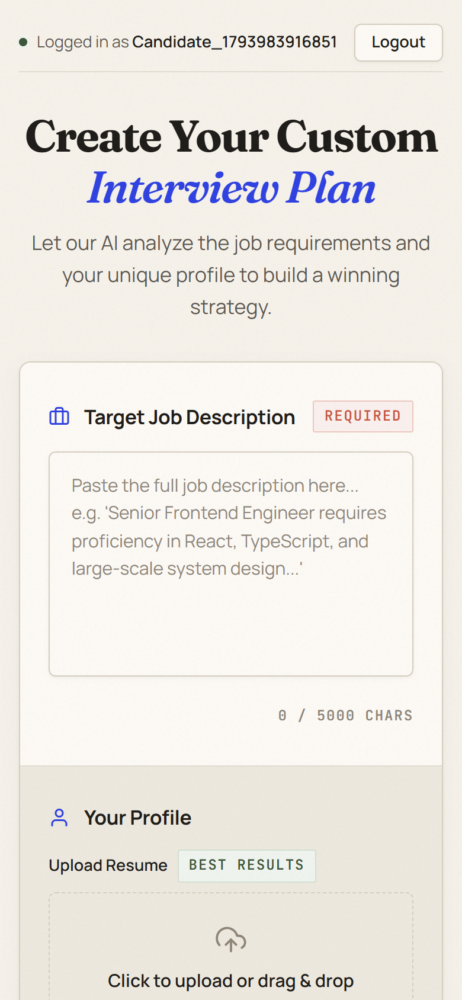 |
| *Touch-friendly file selector with intuitive step instructions.* | *Full-width mobile textarea with proper virtual keyboard viewport handling.* |

---

## 5. Multi-Stage Generation State Machine

HireCraft eliminates generic indeterminate circular spinners. In their place, a deterministic multi-stage state machine guides candidates through the AI analysis pipeline with a mechanical hairline sweep progress indicator:

| Desktop Multi-Stage Loader | Mobile Multi-Stage Loader |
| :---: | :---: |
| 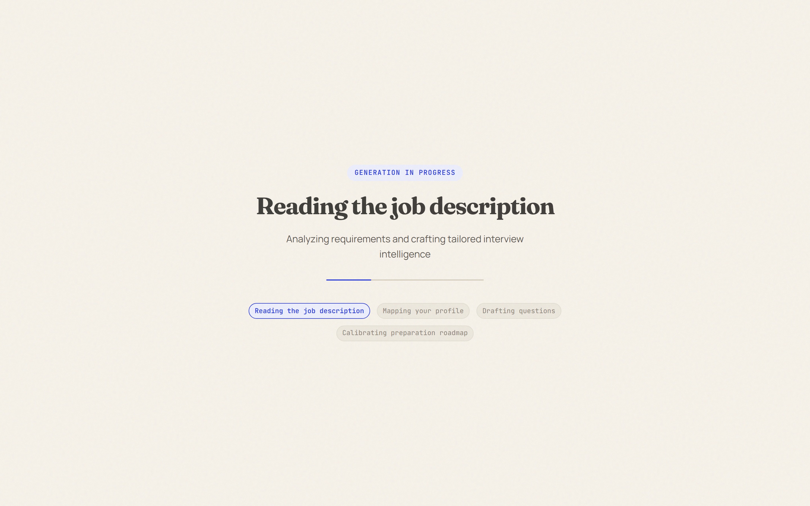 | 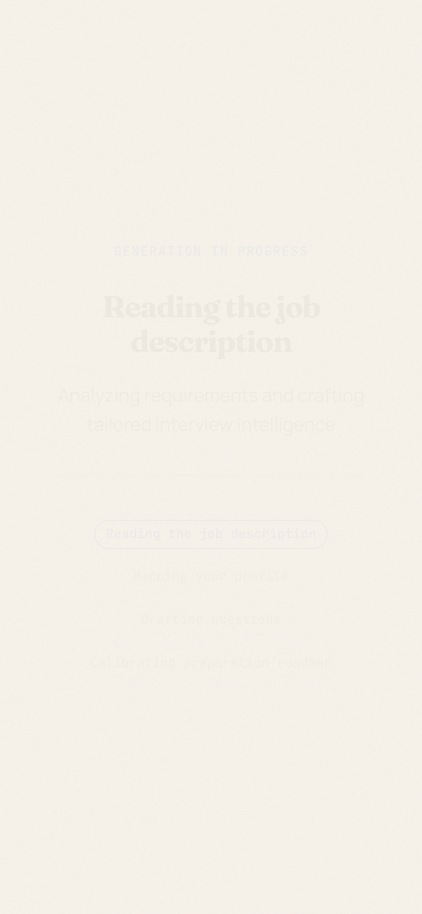 |
| *Sequential rotating stages with mechanical tick states and hairline animation.* | *Centered card ensuring clarity on smaller mobile screens.* |

```
Stage 1: [✓] Parsing resume in-memory & extracting key competencies...
Stage 2: [✓] Reading target job description & mapping role requirements...
Stage 3: [●] Synthesizing calibrated technical inquiries & STAR scenarios...
Stage 4: [ ] Calibrating 5-day action roadmap & ATS resume structure...
```

---

## 6. 3-Column Interview Strategy Intelligence Report

Once generated, candidate intelligence is rendered in a comprehensive 3-column layout:
1. **Left Navigation Rail**: Sticky jump navigation between Technical, Behavioral, and Roadmap sections.
2. **Main Strategy Feed**: Accordion question cards, rationale blockquotes, and timeline items.
3. **Right Summary Rail**: Match score arc, ranked skill gaps, and ATS PDF export action.

### Technical Questions Intelligence
Each question features typographic numbering, rationale explaining the interviewer's intent, and an in-depth model answer.

| Desktop View (1440×900) | Mobile View (390×844) |
| :---: | :---: |
| 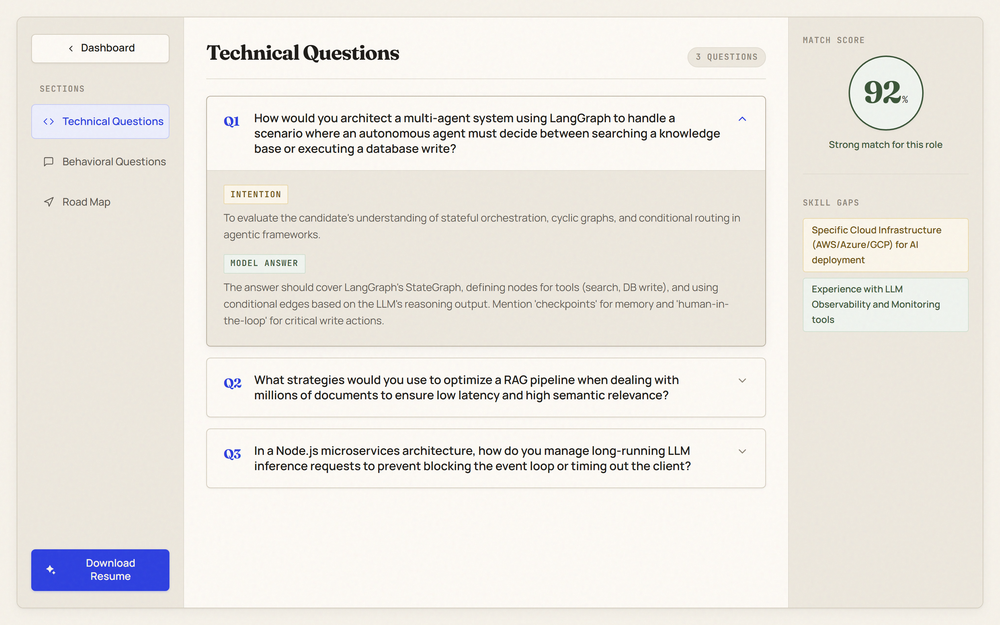 | 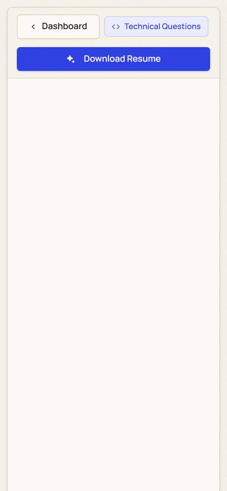 |
| *Expanded accordion showing question intention, evaluation rubric, and model answers.* | *Sticky section tabs allowing effortless switching between strategy categories.* |

---

### STAR Behavioral Scenarios
Behavioral questions specifically calibrated to the candidate's level and role context.

| Desktop Behavioral View | Deep Behavioral Drilldown |
| :---: | :---: |
| 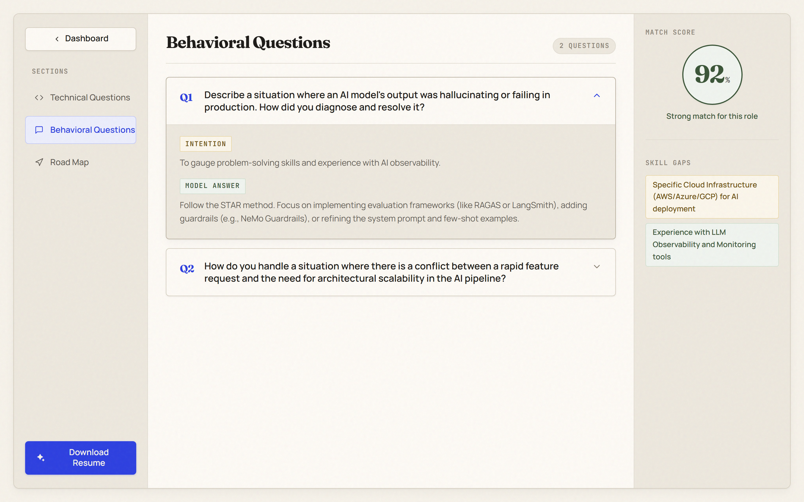 | 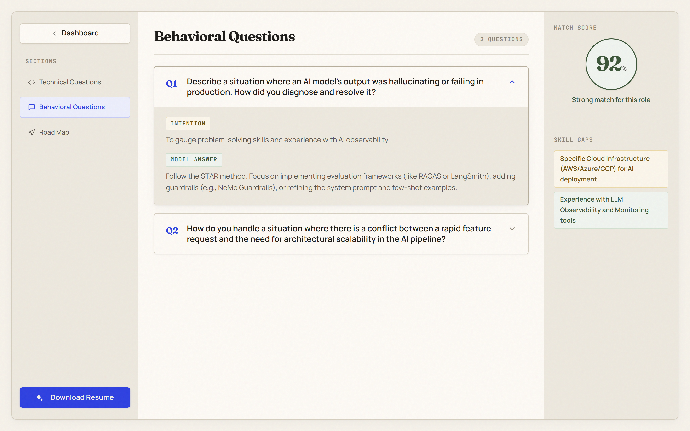 |
| *STAR methodology prompts tailored to leadership signals and real-world system resilience.* | *Detailed breakdown cards with collapsible full model responses.* |

---

### Structured 5-Day Preparation Roadmap
A daily tactical syllabus taking the candidate from core architecture refresh to high-pressure mock simulation.

| Desktop 5-Day Roadmap | Mobile Roadmap Stack |
| :---: | :---: |
| 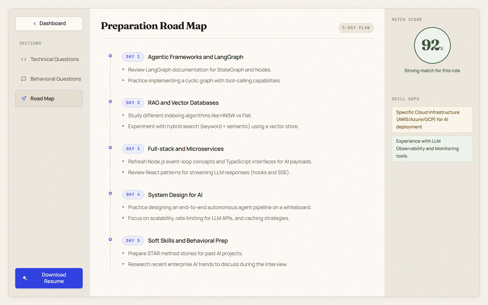 |  |
| *Refined timeline with hairline rules, delicate ring nodes, and day-by-day actionable syllabus.* | *Single-column timeline with accessible vertical flow.* |

---

### Match Score Arc & Categorized Skill Gaps
The hero moment of the analysis: an SVG circular progress indicator displaying the role-match score alongside ranked gaps categorized by severity.

<div align="center">
  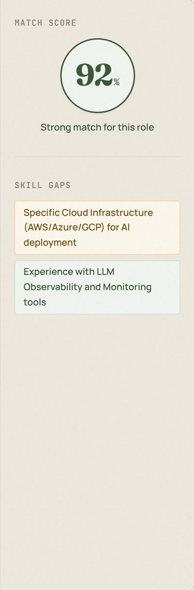
  <p><em>Circular SVG arc with Fraunces numeral display, PDF download trigger, and ranked skill gap cards categorized by semantic severity (Terracotta = High, Butter = Medium, Sage = Low).</em></p>
</div>

---

## 7. Saved Reports History Grid

Candidates can access, review, and re-download any previous interview strategy report from their personal history grid.

| Desktop History Grid | Mobile History Cards |
| :---: | :---: |
| 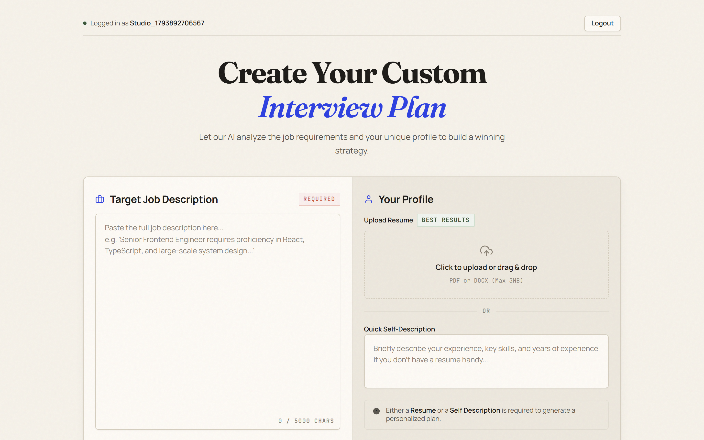 | 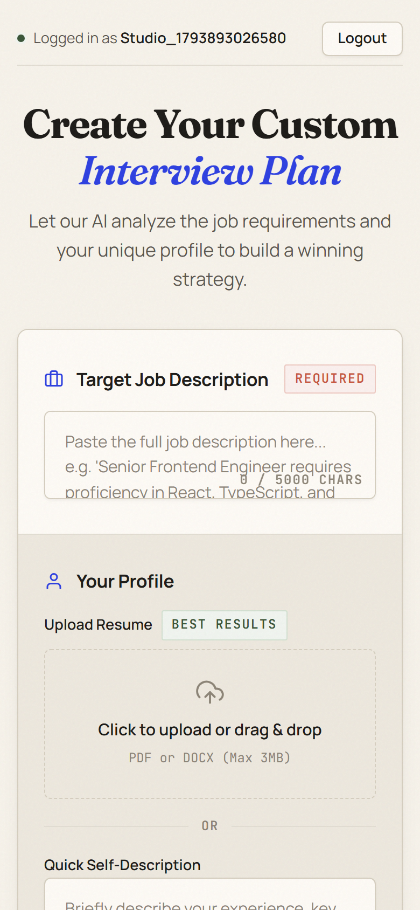 |
| *Historical strategy cards with date timestamps, job title chips, and match percentage pills.* | *Swipeable card list with instant tap-to-review capabilities.* |

---

## 8. Design System Evolution (Before vs After)

HireCraft underwent a systematic design evolution to eliminate visual noise, improve typography, and ensure strict compliance with the **Light Editorial Studio** design system:

| View | Before Evolution | After Evolution (Editorial Polish) |
| :--- | :---: | :---: |
| **Login** | 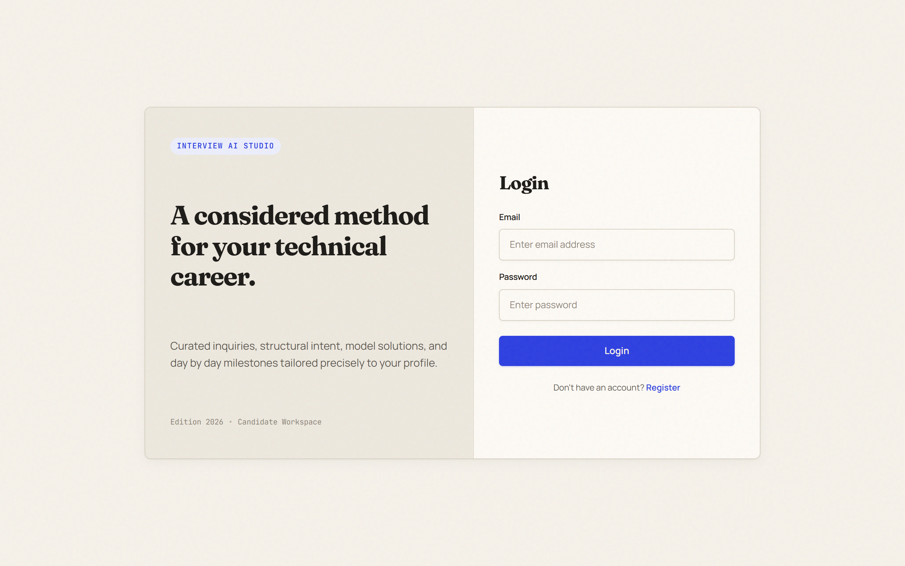 | 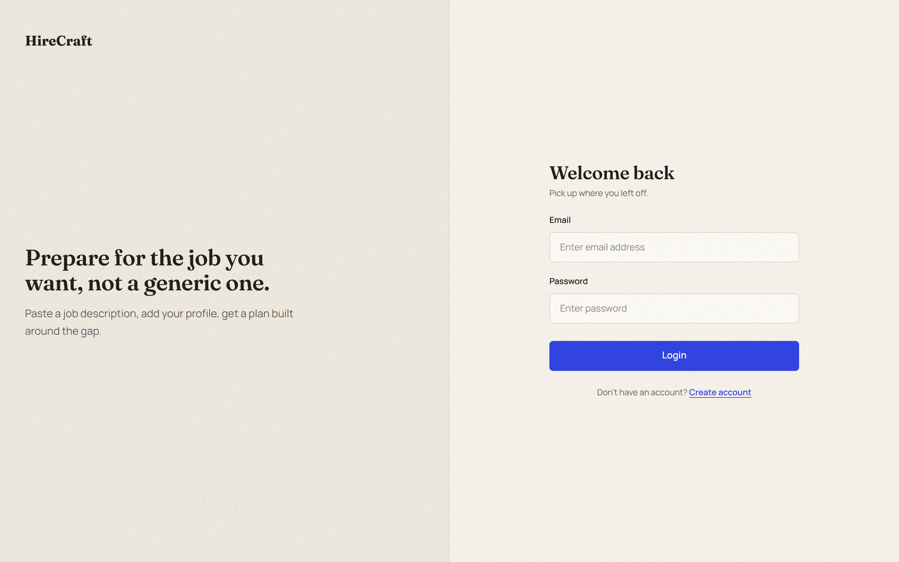 |
| **Register** |  | 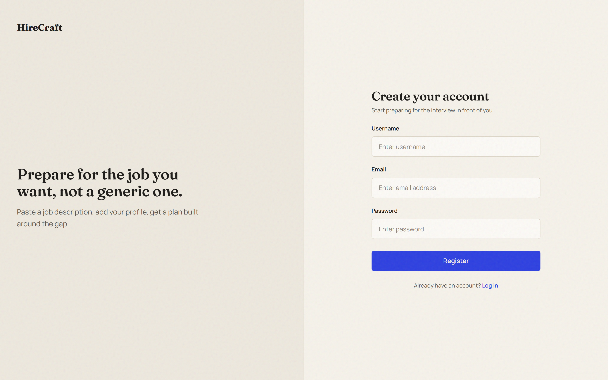 |
| **Workspace** | 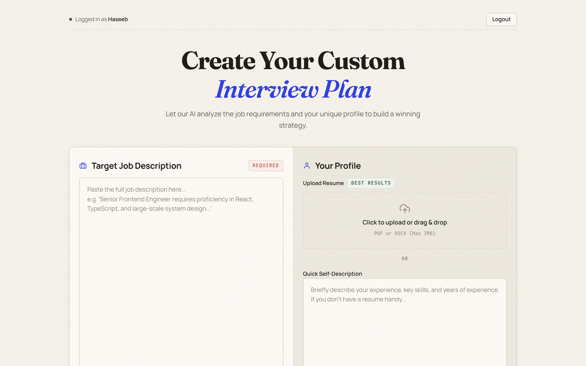 | 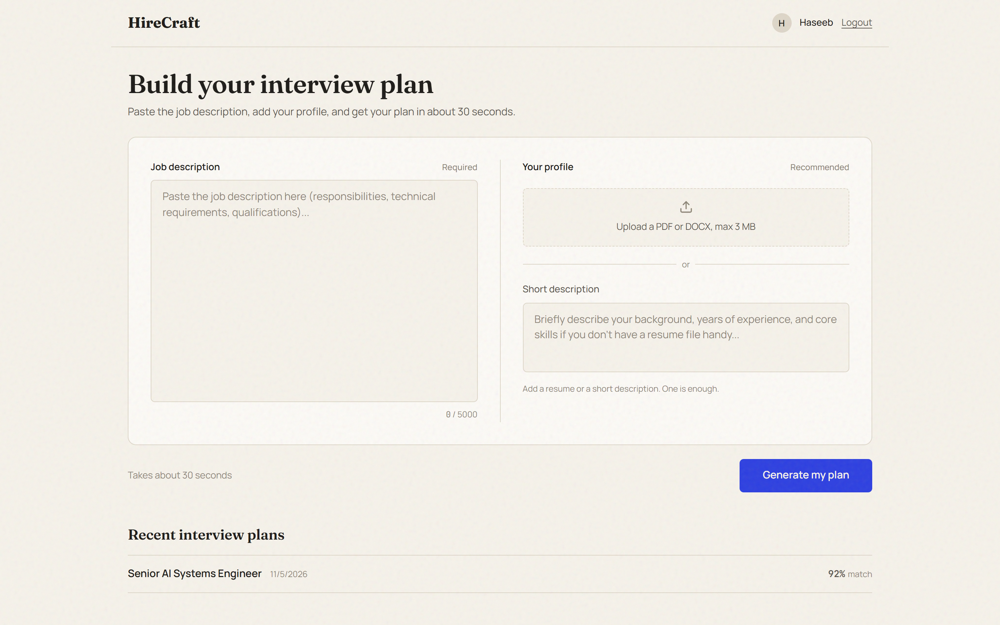 |

---

## 9. Accessibility & Micro-Interaction Standards

- **WCAG AA Contrast**: All body text on `#F6F2EA` paper surface maintains at least 4.5:1 contrast; headlines maintain at least 7:1 contrast.
- **Focus States**: High-visibility double-ring focus styling (`#2D3FE0`) without browser default fuzzy outlines.
- **Motion Reduction**: All transitions respect the `prefers-reduced-motion: reduce` media query via custom Sass mixins (`@include motion.reduced-motion`).
- **Semantic HTML**: Strict document hierarchy with `<header>`, `<nav>`, `<main>`, `<section>`, `<article>`, and `<footer>` landmarks for complete screen reader accessibility.
- **Responsive Breakpoints**: Designed mobile-first across five responsive tiers:
  - Mobile Small: `<= 390px`
  - Mobile: `<= 640px`
  - Tablet: `<= 768px`
  - Laptop: `<= 1024px`
  - Desktop: `>= 1280px`

---

<div align="center">

[← Back to Main README](README.md) • [View Stylesheet Architecture](Frontend/src/styles/)

</div>
